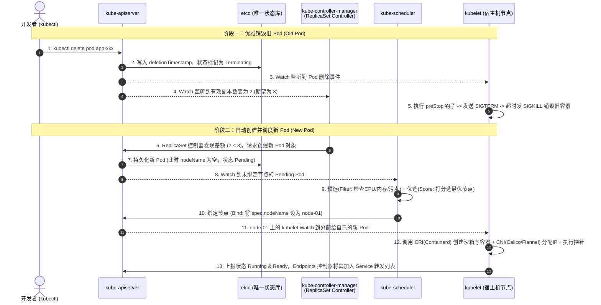

# Kubernetes (K8s) 从“只会删 Pod”到大厂核心实战保姆级通关指南

> **适合人群**：公司环境已由运维/架构师搭好，日常工作仅限于 `kubectl get/logs/delete pod`，感觉只停留在皮毛、缺乏从 0 到 1 实战（尤其是 MQ/Redis 等中间件容器化）和底层深水区经验的开发者。

---

## 目录

1. [模块一：逆向拆解公司现有 YAML（手把手教你“偷师”生产环境）](#模块一逆向拆解公司现有-yaml手把手教你偷师生产环境)
   - [1.1 怎么把公司的配置导出来看？（去噪技巧）](#11-怎么把公司的配置导出来看去噪技巧)
   - [1.2 大厂生产级微服务 YAML 全景逐行拆解（具体例子）](#12-大厂生产级微服务-yaml-全景逐行拆解具体例子)
   - [1.3 逆向拆解时必须留意的 6 大核心命门（不配会出什么事故？）](#13-逆向拆解时必须留意的-6-大核心命门不配会出什么事故)
2. [模块二：Ubuntu/Linux 从 0 到 1 搭建实验环境与完整实战](#模块二ubuntulinux-从-0-到-1-搭建实验环境与完整实战)
   - [2.1 本地集群选型：为什么最推荐 k3s？](#21-本地集群选型为什么最推荐-k3s)
   - [2.2 Step-by-Step：在 Ubuntu 上从 0 搭建 k3s（含验证成功标准）](#22-step-by-step在-ubuntu-上从-0-搭建-k3s含验证成功标准)
   - [2.3 实战一：从 0 部署无状态微服务 + ConfigMap + Ingress + HPA 自动扩缩容](#23-实战一从-0-部署无状态微服务--configmap--ingress--hpa-自动扩缩容)
   - [2.4 实战二：从 0 部署有状态中间件 RabbitMQ（吃透 StatefulSet 与持久化）](#24-实战二从-0-部署有状态中间件-rabbitmq吃透-statefulset-与持久化)
   - [2.5 实战三：故意制造 5 大经典故障并手把手排障](#25-实战三故意制造-5-大经典故障并手把手排障)
3. [模块三：大厂高频深挖原理、架构缺陷与项目实战落地（附流程图）](#模块三大厂高频深挖原理架构缺陷与项目实战落地附流程图)
   - [3.1 深挖一：执行 `kubectl delete pod` 后自动拉起，底层到底经历了哪 10 步？](#31-深挖一执行-kubectl-delete-pod-后自动拉起底层到底经历了哪-10-步)
   - [3.2 深挖二：滚动发布为什么会出现 502 / Connection Reset？如何做到绝对零停机？](#32-深挖二滚动发布为什么会出现-502--connection-reset如何做到绝对零停机)
   - [3.3 深挖三：K8s 网络全链路与 Service 性能瓶颈（iptables vs IPVS）](#33-深挖三k8s-网络全链路与-service-性能瓶颈iptables-vs-ipvs)
   - [3.4 深挖四：大厂最爱问的 3 个容器化隐蔽大坑（CPU 节流、容器 OOM、DNS 5秒延迟）](#34-深挖四大厂最爱问的-3-个容器化隐蔽大坑cpu-节流容器-oomdns-5秒延迟)
   - [3.5 简历与面试转化：如何把这些内容变成你自己的项目亮点？](#35-简历与面试转化如何把这些内容变成你自己的项目亮点)

---

# 模块一：逆向拆解公司现有 YAML（手把手教你“偷师”生产环境）

公司现成的 K8s 环境就是你最好的免费教材。架构师和 SRE 踩过的坑，全写在现有的 YAML 里。

## 1.1 怎么把公司的配置导出来看？（去噪技巧）

平时你只执行 `kubectl get pod -n <你的命名空间>`，现在请你按顺序执行以下命令（只读操作，绝对安全）：

```bash
# 1. 查看你所在命名空间下的全套资源（Deployment, Service, StatefulSet, DaemonSet, HPA）
kubectl get deploy,sts,svc,ing,cm,hpa,pvc -n <your-namespace>

# 2. 导出某个核心业务服务的 Deployment YAML 到本地文件仔细看
kubectl get deploy <your-app-name> -n <your-namespace> -o yaml > my-app-deploy.yaml

# 3. 导出 Service 和 Ingress 看看流量是怎么进来的
kubectl get svc <your-service-name> -n <your-namespace> -o yaml > my-app-svc.yaml
kubectl get ing -n <your-namespace> -o yaml > my-app-ingress.yaml
```

### 导出后怎么看？（过滤干扰项）
直接用 `kubectl get -o yaml` 导出的文件里有很多 K8s 自动生成的运行时字段，**看的时候直接忽略以下部分**：
- `metadata.managedFields`（一大坨字段管理记录，直接跳过）
- `metadata.uid` / `metadata.resourceVersion` / `metadata.generation` / `metadata.creationTimestamp`
- 最底部的 `status:` 块（这是当前状态，看配置重点看 `spec:` 块）

> **小技巧**：如果电脑上有 `kubectl neat` 插件或 `yq`，可以用命令一键洗掉噪音：
> `kubectl get deploy <your-app> -o yaml | grep -v "f:"`

---

## 1.2 大厂生产级微服务 YAML 全景逐行拆解（具体例子）

下面是一份典型的大厂生产级微服务（以订单服务 `order-service` 为例）的完整 YAML。**请你对照公司导出的 YAML，重点留意下面标注 `【★核心关注点】` 的地方**：

```yaml
apiVersion: apps/v1
kind: Deployment
metadata:
  name: order-service
  namespace: prod-mall
  labels:
    app: order-service
    tier: backend
spec:
  replicas: 3 # 【★关注点1】副本数：生产环境至少 >=2 保证高可用
  revisionHistoryLimit: 10 # 保留多少个历史 ReplicaSet 版本用于 kubectl rollout undo 回滚
  
  # 【★关注点2】滚动更新策略：决定了发版时会不会中断业务、发版速度有多快
  strategy:
    type: RollingUpdate
    rollingUpdate:
      maxSurge: 25%        # 升级过程中最多可以比 replicas 多出多少个 Pod（向上浮动）
      maxUnavailable: 0    # 升级过程中最多允许多少个 Pod 不可用（设为0保证容量不降级！）

  selector:
    matchLabels:
      app: order-service

  template:
    metadata:
      labels:
        app: order-service
      annotations:
        # 【★关注点3】Prometheus 监控采集注解或网格(Istio)注解通常藏在这里
        prometheus.io/scrape: "true"
        prometheus.io/port: "8080"
        prometheus.io/path: "/actuator/prometheus"
    spec:
      # 【★关注点4】优雅停机宽限期：给足应用处理完剩余请求、关闭连接池的时间（默认30s）
      terminationGracePeriodSeconds: 45

      # 【★关注点5】反亲和性调度：防止3个Pod全被调度到同一台物理机，物理机断电直接团灭！
      affinity:
        podAntiAffinity:
          preferredDuringSchedulingIgnoredDuringExecution:
            - weight: 100
              podAffinityTerm:
                labelSelector:
                  matchExpressions:
                    - key: app
                      operator: In
                      values:
                        - order-service
                topologyKey: kubernetes.io/hostname # 按宿主机维度打散

      containers:
        - name: order-service
          image: registry.company.com/mall/order-service:v1.4.2 # 【★关注点6】永远不要在生产用 :latest
          imagePullPolicy: IfNotPresent
          ports:
            - name: http
              containerPort: 8080
              protocol: TCP

          # 【★关注点7】环境变量与下行 API（Downward API）：把 Pod 自身信息注入给应用（用于日志染色、监控）
          env:
            - name: TZ
              value: Asia/Shanghai
            - name: POD_IP
              valueFrom:
                fieldRef:
                  fieldPath: status.podIP
            - name: NODE_NAME
              valueFrom:
                fieldRef:
                  fieldPath: spec.nodeName
            - name: JAVA_OPTS
              # 【★关注点8】JVM 容器化参数：避免 JVM 乱占内存被 K8s OOMKill
              value: "-XX:+UseContainerSupport -XX:InitialRAMPercentage=70.0 -XX:MaxRAMPercentage=75.0 -XX:+HeapDumpOnOutOfMemoryError -XX:HeapDumpPath=/logs/dump.hprof"

          # 【★关注点9】资源配额（面试必考 QoS 与 OOM）：
          resources:
            requests:              # 调度依据：节点剩余资源必须满足 requests 才能调度上去
              cpu: "500m"          # 0.5 核
              memory: "1Gi"
            limits:                # 硬性上限：CPU超了会被节流(Throttle)，内存超了直接 OOMKilled(137)
              cpu: "2000m"         # 2 核
              memory: "2Gi"

          # 【★关注点10】三大探针：K8s 自动自愈和不报错发版的灵魂！
          # 1. 启动探针：保护慢启动应用（如传统 SpringBoot 启动要 60s），启动成功前不执行 liveness
          startupProbe:
            httpGet:
              path: /actuator/health/liveness
              port: 8080
            failureThreshold: 30   # 最多尝试 30 次
            periodSeconds: 3       # 每 3 秒一次，即给足 90 秒启动时间

          # 2. 存活探针：判断容器是否“死锁/假死”。失败则直接杀掉重启容器！
          livenessProbe:
            httpGet:
              path: /actuator/health/liveness
              port: 8080
            initialDelaySeconds: 5
            periodSeconds: 10
            timeoutSeconds: 2
            failureThreshold: 3    # 连续 3 次超时才杀，防止偶发 GC 停顿误杀

          # 3. 就绪探针：判断容器“能不能接流量”。失败不杀容器，但会从 Service Endpoints 摘除流量！
          readinessProbe:
            httpGet:
              path: /actuator/health/readiness
              port: 8080
            initialDelaySeconds: 5
            periodSeconds: 5
            timeoutSeconds: 2
            successThreshold: 1
            failureThreshold: 2

          # 【★关注点11】生命周期钩子：配合优雅停机，防止删 Pod 瞬间流量还打进来报 502
          lifecycle:
            preStop:
              exec:
                command: ["/bin/sh", "-c", "sleep 10"]

          # 【★关注点12】目录挂载：配置文件与日志落盘
          volumeMounts:
            - name: app-config
              mountPath: /app/config
              readOnly: true
            - name: app-logs
              mountPath: /logs

      volumes:
        - name: app-config
          configMap:
            name: order-service-cm
        - name: app-logs
          hostPath:
            path: /var/log/k8s-apps/order-service
            type: DirectoryOrCreate
```

---

## 1.3 逆向拆解时必须留意的 6 大核心命门（不配会出什么事故？）

当你看公司的 YAML 时，带着下面这 6 个问题去检查，你立刻就能看出公司架构的优缺点（这也是面试官最喜欢问的实战细节）：

| 检查项 | 怎么看？ | 如果没配或配错了，会发生什么生产事故？ | 最佳实践解决方案 |
| :--- | :--- | :--- | :--- |
| **1. `livenessProbe` 和 `readinessProbe` 的接口一样吗？** | 看两者的 `httpGet.path` 是否都指向同一个 `/health` 且里面检查了 DB/Redis/MQ 连接。 | **灾难级雪崩**：如果 `livenessProbe` 检查了 Redis/MQ，一旦 Redis 抖动，所有微服务 Pod 的存活探针同时失败，引发全站所有 Pod 疯狂重启雪崩！ | `livenessProbe` 只检查进程自身是否假死（绝不检查外部依赖）；`readinessProbe` 才检查 DB/MQ 依赖，依赖挂了只摘流量不重启。 |
| **2. 有没有配 `preStop: sleep`？** | 看 `containers.lifecycle.preStop`。 | 每次发版或者你手动 `kubectl delete pod` 时，前端或上游调用方都会报零星的 `502 Bad Gateway` 或 `Connection refused`。 | 加上 `preStop: sleep 5~10`，让 kube-proxy 和 Ingress 有时间把该 Pod IP 从转发列表摘除后，再真正停止业务进程。 |
| **3. `resources` 的 requests 和 limits 比例是多少？** | 看 CPU 和 Memory 的 `requests` 与 `limits` 差值。 | 1. 如果完全不配：某个内存泄漏的 Pod 会吃光整台宿主机内存，把同节点其他正常服务全部拖死。<br>2. 如果 CPU limit 设得太死（如 `200m`）：多线程突发流量下触发 Linux CFS 节流，CPU 利用率看似不高，但接口 RT 从 10ms 暴增到 800ms。 | 核心服务 Memory 的 `requests == limits`（防止节点内存超卖被杀）；CPU 的 `limits` 设为 `requests` 的 2~4 倍应对突发流量。 |
| **4. Java 应用堆内存设了多少？和 Pod Memory Limit 一样大吗？** | 看 `JAVA_OPTS` 里的 `-Xmx` 或 `-XX:MaxRAMPercentage`。 | 如果 Pod `limits.memory: 2Gi`，而 JVM 设了 `-Xmx2048m`，运行一段时间后必被 K8s 强行杀掉（`OOMKilled, Exit Code 137`），因为 JVM 除了堆内存还有元空间、线程栈、堆外内存（Direct Memory）。 | JVM 最大堆内存只给容器 Limit 的 **70%~75%**，给堆外内存和操作系统留出 25% 缓冲。 |
| **5. `ConfigMap` 挂载用了 `subPath` 吗？** | 看 `volumeMounts` 里有没有写 `subPath: application.yml`。 | 如果用了 `subPath` 挂载单个文件，当你修改了 `ConfigMap` 内容后，**容器内的文件永远不会自动热更新**！必须手动删 Pod 重建才生效。 | 需要热更新的配置挂载整个目录（不用 `subPath`），或者结合 Nacos/Apollo 配置中心。 |
| **6. 是否有 `podAntiAffinity`（反亲和性）？** | 看 `spec.template.spec.affinity`。 | 某业务开了 3 个副本，结果被 Scheduler 全部塞到了 `node-01` 上。半夜 `node-01` 硬件故障宕机，3 个副本同时失联，高可用沦为摆设。 | 配置基于 `kubernetes.io/hostname` 的软反亲和性（`preferredDuringScheduling...`）或 `topologySpreadConstraints`。 |

---

# 模块二：Ubuntu/Linux 从 0 到 1 搭建实验环境与完整实战

光看不练假把式。很多教程让你用 kubeadm 装三台虚拟机，光是翻墙拉镜像、配网络插件就能劝退 90% 的人。
**最适合开发人员在本地 Ubuntu（物理机、虚拟机 VMware/VirtualBox 或 Windows WSL2 的 Ubuntu）从 0 演练的方案是：`k3s`**。

## 2.1 本地集群选型：为什么最推荐 k3s？

- **k3s（强烈推荐）**：Rancher 出品的官方认证轻量级 K8s。它把完整 K8s 的组件打包成了一个小于 100MB 的二进制文件，**自带 Containerd 容器运行时、Flannel 网络插件、CoreDNS、Traefik Ingress、Local-Path StorageClass（本地动态存储卷）**！意味着你装好就能直接测 PVC 持久化和 StatefulSet 消息队列，与生产环境 API **100% 兼容**。
- **Kind (Kubernetes in Docker)**：把 K8s 节点当成 Docker 容器跑，适合快速测多节点调度，但需要你先装好 Docker。

下面以 **Ubuntu 20.04 / 22.04 / 24.04** 为例，带你用 **k3s** 手把手从 0 搭起全功能集群。

---

## 2.2 Step-by-Step：在 Ubuntu 上从 0 搭建 k3s（含验证成功标准）

### 第一步：Ubuntu 基础环境准备（打开终端执行）

```bash
# 1. 关闭防火墙或放行端口（实验环境直接关掉 ufw 避免网络不通）
sudo systemctl stop ufw && sudo systemctl disable ufw

# 2. 关闭 Swap 交换分区（K8s 要求关闭 swap 以保证内存调度准确）
sudo swapoff -a
sudo sed -i '/ swap / s/^\(.*\)$/#\1/g' /etc/fstab

# 3. 检查内存与磁盘（建议至少 2核 4G 内存，20G 磁盘空间）
free -h
df -h
```

### 第二步：配置国内镜像加速并一键安装 k3s

为了防止国内网络拉取 Docker Hub / Rancher 镜像超时，我们先写入镜像加速配置，再执行国内阿里云镜像源安装脚本：

```bash
# 1. 创建 k3s 容器镜像加速配置目录
sudo mkdir -p /etc/rancher/k3s

# 2. 写入国内镜像源加速配置 (registries.yaml)
cat <<EOF | sudo tee /etc/rancher/k3s/registries.yaml
mirrors:
  docker.io:
    endpoint:
      - "https://docker.m.daocloud.io"
      - "https://mirror.ccs.tencentyun.com"
  registry.k8s.io:
    endpoint:
      - "https://k8s.m.daocloud.io"
EOF

# 3. 使用国内镜像源一键安装 k3s（耗时约 1~2 分钟）
curl -sfL https://rancher-mirror.rancher.cn/k3s/k3s-install.sh | INSTALL_K3S_MIRROR=cn sh -
```

### 第三步：配置 `kubectl` 权限（让普通用户也能直接用命令）

```bash
# 1. 将 k3s 生成的 kubeconfig 复制到当前用户的 ~/.kube/config
mkdir -p ~/.kube
sudo cp /etc/rancher/k3s/k3s.yaml ~/.kube/config
sudo chown $(id -u):$(id -g) ~/.kube/config
export KUBECONFIG=~/.kube/config
echo "export KUBECONFIG=~/.kube/config" >> ~/.bashrc
```

### 第四步：怎么才算搭建成功？（验收标准）

依次执行下面 3 条命令，对照输出确认你的集群 100% 健康可用：

```bash
# 验收 1：查看节点状态，STATUS 必须为 Ready
kubectl get nodes -o wide
```
**预期成功输出**：
```text
NAME           STATUS   ROLES                  AGE   VERSION        INTERNAL-IP
ubuntu-local   Ready    control-plane,master   2m    v1.29.x+k3s1   192.168.x.x
```

```bash
# 验收 2：查看系统核心组件 Pod，全部必须是 Running 或 Completed
kubectl get pods -n kube-system
```
**预期成功输出**（你会看到以下核心组件全部就绪）：
- `coredns-xxx` (`1/1 Running`) —— 集群内部 DNS 解析服务
- `local-path-provisioner-xxx` (`1/1 Running`) —— 动态持久化存储分配器（后面装 MQ 全靠它自动创建存储卷！）
- `metrics-server-xxx` (`1/1 Running`) —— 监控指标采集（让你能用 `kubectl top` 和 `HPA` 自动扩容！）
- `traefik-xxx` (`1/1 Running`) —— Ingress 控制器（管理外部域名流量接入！）

```bash
# 验收 3：查看默认存储类 StorageClass，确认 local-path (default) 存在
kubectl get sc
```
看到 `local-path (default)`，恭喜你！你已经有了一套五脏俱全的准生产级 K8s 实验场！

---

## 2.3 实战一：从 0 部署无状态微服务 + ConfigMap + Ingress + HPA 自动扩缩容

不要只跑一个孤零零的 Pod，我们要模拟真实企业项目：**独立命名空间 + 外部配置注入 (ConfigMap) + 多副本部署 (Deployment) + 内部负载均衡 (Service) + 域名路由 (Ingress) + 自动弹性伸缩 (HPA)**。

### Step 1：创建专属命名空间与编写全套配置文件

```bash
# 1. 创建实验目录与命名空间
mkdir -p ~/k8s-labs/01-stateless-app && cd ~/k8s-labs/01-stateless-app
kubectl create namespace demo-prod

# 2. 创建包含 ConfigMap + Deployment + Service + Ingress + HPA 的完整 YAML
cat <<'EOF' > app-fullstack.yaml
apiVersion: v1
kind: ConfigMap
metadata:
  name: web-config
  namespace: demo-prod
data:
  index.html: |
    <html>
    <head><title>K8s Real Practice</title></head>
    <body style="font-family: sans-serif; padding: 20px;">
      <h1>Hello from Kubernetes Pod!</h1>
      <p>Env Config Loaded Successfully: <b>v1.0.0</b></p>
    </body>
    </html>
---
apiVersion: apps/v1
kind: Deployment
metadata:
  name: order-web
  namespace: demo-prod
spec:
  replicas: 2
  strategy:
    type: RollingUpdate
    rollingUpdate:
      maxSurge: 1
      maxUnavailable: 0
  selector:
    matchLabels:
      app: order-web
  template:
    metadata:
      labels:
        app: order-web
    spec:
      terminationGracePeriodSeconds: 30
      containers:
        - name: nginx
          image: nginx:1.25-alpine
          ports:
            - containerPort: 80
          resources:
            requests:
              cpu: "50m"
              memory: "64Mi"
            limits:
              cpu: "200m"
              memory: "128Mi"
          readinessProbe:
            httpGet:
              path: /
              port: 80
            initialDelaySeconds: 2
            periodSeconds: 3
          livenessProbe:
            httpGet:
              path: /
              port: 80
            initialDelaySeconds: 5
            periodSeconds: 10
          lifecycle:
            preStop:
              exec:
                command: ["/bin/sh", "-c", "sleep 3 && nginx -s quit"]
          volumeMounts:
            - name: html-volume
              mountPath: /usr/share/nginx/html
      volumes:
        - name: html-volume
          configMap:
            name: web-config
---
apiVersion: v1
kind: Service
metadata:
  name: order-web-svc
  namespace: demo-prod
spec:
  type: ClusterIP
  selector:
    app: order-web
  ports:
    - port: 80
      targetPort: 80
---
apiVersion: networking.k8s.io/v1
kind: Ingress
metadata:
  name: order-web-ing
  namespace: demo-prod
spec:
  rules:
    - host: order.local.com
      http:
        paths:
          - path: /
            pathType: Prefix
            backend:
              service:
                name: order-web-svc
                port:
                  number: 80
---
apiVersion: autoscaling/v2
kind: HorizontalPodAutoscaler
metadata:
  name: order-web-hpa
  namespace: demo-prod
spec:
  scaleTargetRef:
    apiVersion: apps/v1
    kind: Deployment
    name: order-web
  minReplicas: 2
  maxReplicas: 6
  metrics:
    - type: Resource
      resource:
        name: cpu
        target:
          type: Utilization
          averageUtilization: 50 # 当平均 CPU 使用率超过 requests(50m) 的 50% 时自动扩容！
EOF
```

### Step 2：部署并全方位验证链路

```bash
# 1. 一键应用配置
kubectl apply -f app-fullstack.yaml

# 2. 观察 Pod 启动过程、IP 分配和 Endpoints 挂载
kubectl get pods,svc,ep,ing,hpa -n demo-prod -o wide
```

**怎么验证你真正打通了整条链路？**
1. **验证 Endpoints 自动绑定**：看 `kubectl get ep order-web-svc -n demo-prod`，你会看到它的 `ENDPOINTS` 列正好是你那 2 个 Pod 的内网 IP！
2. **验证 Ingress 域名访问**：
   ```bash
   # 模拟域名请求打入本机 80 端口（k3s 的 Traefik Ingress 默认监听宿主机 80 端口）
   curl -H "Host: order.local.com" http://127.0.0.1/
   ```
   看到输出 `<h1>Hello from Kubernetes Pod!</h1>`，说明 **外部请求 -> Ingress -> Service -> Pod -> ConfigMap 挂载页面** 全链路打通！
3. **验证 HPA 自动扩缩容（亲眼看看流量洪峰时 K8s 怎么自动加机器）**：
   打开一个新终端窗口监控 HPA 和 Pod 数量变化：
   ```bash
   kubectl get hpa,pods -n demo-prod -w
   ```
   在原终端启动一个临时压测容器疯狂请求 `order-web-svc`：
   ```bash
   kubectl run -i --tty load-generator --rm --image=busybox:1.36 --restart=Never -n demo-prod -- /bin/sh -c "while sleep 0.001; do wget -q -O- http://order-web-svc; done"
   ```
   等待约 30~45 秒，你会亲眼看到 HPA 的 `TARGETS` 从 `0%/50%` 飙升到 `180%/50%`，随后 `order-web` 自动从 2 个 Pod 扩容到 4 个、6 个！按下 `Ctrl+C` 停止压测，几分钟后自动缩容回 2 个！

---

## 2.4 实战二：从 0 部署有状态中间件 RabbitMQ（吃透 StatefulSet 与持久化）

你在提问中专门提到：“**自己有没有具体实战使用里面的 MQ 等等**”。大厂面试问中间件容器化，核心就是考 **StatefulSet、Headless Service、PV/PVC 以及为什么有状态服务不能用 Deployment**。

### 先搞懂核心问题：为什么 RabbitMQ / Kafka / Redis 集群不能用 Deployment，必须用 StatefulSet？

如果用 `Deployment` 部署 3 个 RabbitMQ 节点组成集群，会遇到 3 个致命死穴：
1. **网络名字随机且变动（找不到队友）**：Deployment 的 Pod 名字是随机哈希（如 `mq-7d8f9-ax92b`），一旦挂掉重建，**Pod 名字和 IP 全变了**！而 RabbitMQ / Kafka / ZooKeeper 集群节点之间需要固定的节点名（如 `rabbit@rabbitmq-0.rabbitmq-headless...`）来同步元数据和选举主从。
2. **共享同一个存储卷导致数据写坏**：Deployment 所有副本只能共享同一个 PVC。3 个 MQ 节点同时往同一个磁盘目录写持久化队列文件，瞬间文件锁冲突损坏。
3. **无序启停导致脑裂**：MQ 集群初始化通常要求主节点（`0`号节点）先启动，从节点依次加入。Deployment 是所有副本一窝蜂同时启动。

**`StatefulSet` 是怎么解决这三大死穴的？**
1. **固定且有序的 Pod 名称 + Headless Service**：Pod 名字固定为 `rabbitmq-0`、`rabbitmq-1`、`rabbitmq-2`。删掉 `rabbitmq-0`，新建出来的还叫 `rabbitmq-0`！配合 `clusterIP: None` 的 Headless Service，每个 Pod 拥有固定不变的内网域名：`rabbitmq-0.rabbitmq-headless.demo-prod.svc.cluster.local`。
2. **独享存储卷模板 (`volumeClaimTemplates`)**：为每个 Pod 自动创建独立专属的 PVC（`data-rabbitmq-0`、`data-rabbitmq-1`）。哪怕 `rabbitmq-0` 被删掉重新调度到别的机器，它依然挂载回原来的 `data-rabbitmq-0` 磁盘，消息一条不丢！
3. **严格有序启停**：`0` 号节点 `Ready` 后才启动 `1` 号；缩容时先删 `2` 号再删 `1` 号。

---

### Step 1：手写 RabbitMQ StatefulSet 完整生产级演练 YAML

```bash
mkdir -p ~/k8s-labs/02-stateful-mq && cd ~/k8s-labs/02-stateful-mq

cat <<'EOF' > rabbitmq-statefulset.yaml
# 1. 创建 Secret 存放 RabbitMQ 集群节点间通信的 Erlang Cookie 和管理员密码
apiVersion: v1
kind: Secret
metadata:
  name: rabbitmq-secret
  namespace: demo-prod
type: Opaque
stringData:
  RABBITMQ_ERLANG_COOKIE: "SWQOKODSQALRPCLNMEQG" # 集群节点认证密钥
  RABBITMQ_DEFAULT_USER: "admin"
  RABBITMQ_DEFAULT_PASS: "Admin@123"
---
# 2. 创建 Headless Service（无头服务，clusterIP: None），为每个 Pod 提供固定 DNS 域名
apiVersion: v1
kind: Service
metadata:
  name: rabbitmq-headless
  namespace: demo-prod
spec:
  clusterIP: None # 【★核心】不分配虚拟 IP，DNS 直接返回具体 Pod IP，支撑 rabbitmq-0.rabbitmq-headless 固定域名
  selector:
    app: rabbitmq
  ports:
    - name: amqp
      port: 5672
    - name: management
      port: 15672
    - name: epmd
      port: 4369
    - name: cluster-rpc
      port: 25672
---
# 3. 创建供业务微服务客户端连接和外部访问 Web 控制台的普通 Service
apiVersion: v1
kind: Service
metadata:
  name: rabbitmq-client-svc
  namespace: demo-prod
spec:
  type: NodePort
  selector:
    app: rabbitmq
  ports:
    - name: amqp
      port: 5672
      targetPort: 5672
    - name: management
      port: 15672
      targetPort: 15672
      nodePort: 31672 # 方便你在浏览器通过 http://<Ubuntu-IP>:31672 访问 RabbitMQ 管理后台
---
# 4. 创建 StatefulSet 管理有状态 RabbitMQ
apiVersion: apps/v1
kind: StatefulSet
metadata:
  name: rabbitmq
  namespace: demo-prod
spec:
  serviceName: "rabbitmq-headless" # 【★核心】必须绑定上面的 Headless Service 名称
  replicas: 2                      # 演练启动 2 个有序节点：rabbitmq-0 和 rabbitmq-1
  selector:
    matchLabels:
      app: rabbitmq
  template:
    metadata:
      labels:
        app: rabbitmq
    spec:
      terminationGracePeriodSeconds: 30
      containers:
        - name: rabbitmq
          image: rabbitmq:3.12-management-alpine
          ports:
            - name: amqp
              containerPort: 5672
            - name: management
              containerPort: 15672
          envFrom:
            - secretRef:
                name: rabbitmq-secret
          env:
            - name: MY_POD_NAME
              valueFrom:
                fieldRef:
                  fieldPath: metadata.name
            # 【★核心】使用固定域名作为 RabbitMQ 节点名称，重启 IP 变了但节点身份不变！
            - name: RABBITMQ_USE_LONGNAME
              value: "true"
            - name: RABBITMQ_NODENAME
              value: "rabbit@$(MY_POD_NAME).rabbitmq-headless.demo-prod.svc.cluster.local"
          resources:
            requests:
              cpu: "100m"
              memory: "256Mi"
            limits:
              cpu: "500m"
              memory: "512Mi"
          readinessProbe:
            exec:
              command: ["rabbitmq-diagnostics", "ping"]
            initialDelaySeconds: 10
            periodSeconds: 10
            timeoutSeconds: 5
          livenessProbe:
            exec:
              command: ["rabbitmq-diagnostics", "status"]
            initialDelaySeconds: 30
            periodSeconds: 30
            timeoutSeconds: 10
          volumeMounts:
            - name: rabbitmq-data
              mountPath: /var/lib/rabbitmq
  # 【★核心】动态存储卷模板：每个 Pod 自动申请一个专属的 1Gi PVC 持久化磁盘！
  volumeClaimTemplates:
    - metadata:
        name: rabbitmq-data
      spec:
        accessModes: ["ReadWriteOnce"]
        storageClassName: "local-path" # 使用 k3s 自带的动态存储类
        resources:
          requests:
            storage: 1Gi
EOF
```

### Step 2：部署并亲手做 4 个硬核实验（面试吹牛的底气来源！）

```bash
# 1. 部署 RabbitMQ StatefulSet
kubectl apply -f rabbitmq-statefulset.yaml

# 2. 实时观察有序启动过程（你会发现 rabbitmq-0 变成 1/1 Running 之后，才开始创建 rabbitmq-1！）
kubectl get pods -n demo-prod -l app=rabbitmq -w
```

等两个 Pod 都变成 `1/1 Running` 后，依次做下面 4 个实验：

#### 实验 A：查看自动生成的独享 PVC 与 PV
```bash
kubectl get pvc,pv -n demo-prod
```
你会看到 K8s 自动创建了两个独立的持久化声明：`rabbitmq-data-rabbitmq-0` 和 `rabbitmq-data-rabbitmq-1`，分别绑定到了宿主机 `/var/lib/rancher/k3s/storage/` 下的独立物理目录。

#### 实验 B：验证 Headless Service 固定 DNS 解析
```bash
# 在容器内 ping 固定域名
kubectl exec -it rabbitmq-0 -n demo-prod -- nslookup rabbitmq-0.rabbitmq-headless.demo-prod.svc.cluster.local
kubectl exec -it rabbitmq-0 -n demo-prod -- nslookup rabbitmq-1.rabbitmq-headless.demo-prod.svc.cluster.local
```
你会发现每个 Pod 都有自己专属且固定的 DNS A 记录！

#### 实验 C：把 `rabbitmq-1` 加入 `rabbitmq-0` 组成高可用集群
```bash
# 让 1 号节点加入 0 号节点的集群
kubectl exec -it rabbitmq-1 -n demo-prod -- /bin/sh -c "rabbitmqctl stop_app && rabbitmqctl reset && rabbitmqctl join_cluster rabbit@rabbitmq-0.rabbitmq-headless.demo-prod.svc.cluster.local && rabbitmqctl start_app"

# 查看集群状态（看到两个节点都在 running_nodes 列表里！）
kubectl exec -it rabbitmq-0 -n demo-prod -- rabbitmqctl cluster_status
```

#### 实验 D：模拟节点灾难重启，验证消息持久化不丢失！
```bash
# 1. 通过管理接口在 rabbitmq-0 上创建一个持久化队列 test_durable_queue 并写入一条消息
kubectl exec -it rabbitmq-0 -n demo-prod -- rabbitmqadmin -u admin -p Admin@123 declare queue name=test_durable_queue durable=true
kubectl exec -it rabbitmq-0 -n demo-prod -- rabbitmqadmin -u admin -p Admin@123 publish routing_key=test_durable_queue payload="Important Order ID 998877" properties='{"delivery_mode":2}'

# 2. 查询队列里有 1 条消息
kubectl exec -it rabbitmq-0 -n demo-prod -- rabbitmqctl list_queues name messages

# 3. 暴力删掉 rabbitmq-0 Pod！
kubectl delete pod rabbitmq-0 -n demo-prod

# 4. 等待新 rabbitmq-0 重新 Running（注意它的 Pod IP 已经变了，但名字还叫 rabbitmq-0，且重新挂载了原来的 PVC）
kubectl get pod rabbitmq-0 -n demo-prod -o wide -w

# 5. 再次查询队列消息——消息依然完好无损！
kubectl exec -it rabbitmq-0 -n demo-prod -- rabbitmqctl list_queues name messages
```
> **恭喜你！** 做完这 4 步，你在面试时被问到“你们的 MQ / Redis 在 K8s 里是怎么部署的？和业务无状态服务有什么区别？”，你已经能把 `Headless Service`、`RABBITMQ_NODENAME` 固定长域名、`volumeClaimTemplates` 独立 PVC 绑定讲得比 90% 的候选人都透彻！

---

## 2.5 实战三：故意制造 5 大经典故障并手把手排障

平时只会删 Pod，是因为没见过各种报错状态。现在我们在本地环境**故意制造 5 种大厂最常见的故障**，并掌握标准排障三板斧：
1. `kubectl get pod -n <ns>`（看 STATUS 状态码）
2. `kubectl describe pod <pod-name> -n <ns>`（拉到最底下看 `Events` 事件和 `Last State: Terminated Reason/Exit Code`）
3. `kubectl logs <pod-name> -n <ns> --previous`（看上一个崩溃死掉的容器死前最后打出的日志！）

| 故障实验 | 如何一行命令在你的 k3s 里复现出来？ | 报错现象 (`STATUS`) | 怎么用命令精准定位根因？ |
| :--- | :--- | :--- | :--- |
| **1. 内存溢出被内核强杀** | 启动一个分配 200M 内存但 Limit 只有 50M 的 Pod：<br>`kubectl run oom-demo --image=polinux/stress --limits="memory=50Mi" -n demo-prod -- stress --vm 1 --vm-bytes 200M` | `OOMKilled` -> `CrashLoopBackOff` | 执行 `kubectl describe pod oom-demo -n demo-prod`，查看 `Last State: Terminated`，`Reason: OOMKilled`，`Exit Code: 137`（128 + 9 SIGKILL）。 |
| **2. 资源不足无法调度** | 申请 100 核 CPU：<br>`kubectl run pending-demo --image=nginx:alpine --requests="cpu=100" -n demo-prod` | 一直卡在 `Pending` | 执行 `kubectl describe pod pending-demo -n demo-prod`，最底部 `Events` 明确报错：`0/1 nodes are available: 1 Insufficient cpu.` |
| **3. 存活探针配错导致无限重启** | 把 `livenessProbe` 的端口改成不存在的 `9999` 端口 | 先 Running 几十秒，然后 `RESTARTS` 次数不断 +1，最终 `CrashLoopBackOff` | `describe pod` 的 `Events` 中看到：`Liveness probe failed: dial tcp ...:9999: connect: connection refused` -> `Container will be restarted`。 |
| **4. 就绪探针失败导致 Service 503** | 把 `readinessProbe` 路径改成 `/not-exist-404` | Pod 状态是 `Running`，但 `READY` 列一直显示 `0/1`，访问 Service 不通 | 执行 `kubectl get ep <svc-name> -n demo-prod`，发现 `ENDPOINTS` 为 `<none>`！因为没过就绪探针，K8s 拒绝把流量导入该 Pod。 |
| **5. 清理所有实验故障 Pod** | `kubectl delete pod oom-demo pending-demo -n demo-prod` | 恢复干净 | — |

---

# 模块三：大厂高频深挖原理、架构缺陷与项目实战落地（附流程图）

大厂（阿里、字节、腾讯、美团等）面试 K8s，绝不会只问“Deployment 是什么”，而是围绕**底层控制循环机制、并发时序缺陷、网络性能瓶颈、容器资源隔离假象**来深挖。下面把最核心的 4 个高频深挖题拆解成流程图和标准答案。

---

## 3.1 深挖一：执行 `kubectl delete pod` 后自动拉起，底层到底经历了哪 10 步？

你在问题中说：“*只会用命令删除 app 就自动启，感觉自己没有接触核心*”。其实**“删掉一个 Pod 为什么会自动启动一个新的”**，正是 K8s 架构最核心的考题！

### 核心流程图（控制循环 Reconcile Loop & List-Watch 机制）



### 面试深挖难点：
**问：所有组件都在监听 `kube-apiserver`，如果集群有 5000 个节点，APIServer 和 etcd 为什么不会被查询打挂？如果网络闪断导致 Watch 消息丢了怎么办？**
- **难点解析（Informer 机制）**：
  1. 组件不是每秒去轮询（Polling）数据库，而是通过客户端库 `client-go` 的 **Informer** 机制：先执行一次 `List` 获取全量数据放入本地内存缓存（`Indexer`），然后通过 HTTP 分块传输（Chunked）长连接执行 `Watch` 接收增量变更事件。
  2. **消息不丢保障**：每个对象都有递增的 `resourceVersion`（底层对应 etcd 的 revision）。如果长连接闪断，Reflector 重新连接时会带上本地最新的 `resourceVersion` 断点续传；如果断连太久超出 etcd 历史窗口，则自动触发重新 `List` 并与本地缓存比对（Resync），写入 `DeltaFIFO` 队列交由 Worker 幂等处理（**面向终态的水平触发 Level-Triggered**，而非边缘触发，所以哪怕中间丢了一次事件，只要当前状态 $\neq$ 期望状态，控制器就会持续纠偏）。

---

## 3.2 深挖二：滚动发布为什么会出现 502 / Connection Reset？如何做到绝对零停机？

### 缺陷根因（为什么默认配置下删 Pod 必掉量？）
很多人以为：删 Pod 时，K8s 会先把流量切走，再停容器。**大错特错！**
在 K8s 底层，当你删除 Pod 时，APIServer 发出通知后，**两条链路是完全异步并发执行的**（没有先后锁同步）：

```mermaid
flowchart TD
    A[Pod 被标记为 Terminating] --> B[链路1: kubelet 开始停容器]
    A --> C[链路2: EndpointController 开始摘除流量]

    subgraph 链路1：节点侧停止容器 (极快，毫秒级)
        B --> B1[若无 preStop，立即向容器进程发送 SIGTERM]
        B1 --> B2[SpringBoot/Go 收到信号立即关闭 8080 端口监听!]
    end

    subgraph 链路2：网络侧摘除流量 (较慢，需 1~5 秒)
        C --> C1[EndpointsController 调用 APIServer 移除该 Pod IP]
        C1 --> C2[各节点 kube-proxy / Ingress Controller Watch 到变更]
        C2 --> C3[更新宿主机 iptables / IPVS 规则或 Nginx upstream]
    end

    B2 -.->|时间差窗口：端口已关，但 iptables/Ingress 还没更新完！| ERR[❌ 新进来的请求依然被转发给该 Pod，直接报错 502 / Connection Refused!]
    C3 -.-> ERR
```

### 彻底解决的 4 步黄金方案（项目实战必答）：
如果不解决，每次白天发版或者 HPA 缩容，监控大盘都会出现一批 502 报错，甚至导致支付/下单失败。解决方法必须**“K8s 侧 + 应用代码侧”双管齐下**：

1. **K8s 配置 `preStop` 钩子延迟发信号**：
   配置 `lifecycle.preStop.exec.command: ["/bin/sh", "-c", "sleep 10"]`。让 `链路1` 故意等 10 秒再发 `SIGTERM`，确保 `链路2`（kube-proxy 和 Ingress）早已把该 Pod IP 从负载均衡列表里彻底踢出，不会再有新请求打进来。
2. **应用层开启优雅停机（Graceful Shutdown）**：
   光等 10 秒不够，10 秒前已经打进容器正在执行的慢请求（比如耗时 3 秒的数据库事务）不能被腰斩！
   - **Spring Boot (2.3+)**：配置 `server.shutdown=graceful` 和 `spring.lifecycle.timeout-per-shutdown-phase=30s`。收到 `SIGTERM` 后停止接收新请求，等待已进入的请求执行完毕并正常关闭连接池、注销 Nacos/Eureka、提交 MQ 消费位点。
3. **调大 K8s 强杀宽限期 `terminationGracePeriodSeconds`**：
   必须满足：`terminationGracePeriodSeconds (如 45s)` $>$ `preStop sleep (10s)` $+$ `应用优雅停机最长时间 (30s)`。否则时间一到，kubelet 直接发 `SIGKILL (kill -9)` 强杀。
4. **容器启动脚本必须用 `exec`（大坑预警！）**：
   Dockerfile 的 `ENTRYPOINT` 如果写成 shell 格式（如 `sh start.sh`），容器内 `PID 1` 一号进程是 `/bin/sh` 而不是 `java`。`/bin/sh` 不会把 `SIGTERM` 转发给子进程 `java`，导致优雅停机完全失效，苦等 45 秒后被 `kill -9` 强杀！必须在 `start.sh` 最后一行写 `exec java $JAVA_OPTS -jar app.jar`，让 Java 进程成为 `PID 1`。

---

## 3.3 深挖三：K8s 网络全链路与 Service 性能瓶颈（iptables vs IPVS）

### 流量全链路图（从用户浏览器到跨节点 Pod）

```mermaid
flowchart LR
    Client([外部客户端]) -->|1. 域名访问| LB[云厂商 SLB / MetalLB]
    LB -->|2. 转发至 Ingress| ING[Ingress Controller<br/>Nginx / Traefik Pod]
    
    subgraph NodeA [宿主机 Node A]
        ING -->|3. 直接走 Pod IP<br/>跳过 Service VIP| VETH1[veth pair 虚拟网卡对]
        VETH1 --> CNI1[cni0 网桥 / Flannel / Calico]
    end

    subgraph NodeB [宿主机 Node B]
        CNI2[CNI 插件解包 / 路由] --> VETH2[veth pair]
        VETH2 --> POD[目标业务 Pod<br/>10.42.2.15:8080]
    end

    CNI1 -->|4. 跨节点 VXLAN 封包或 BGP 路由| CNI2

    subgraph 集群内部东西向调用 (Service A 调 Service B)
        AppA[调用方 Pod A] -->|访问 Service ClusterIP<br/>10.43.0.100:80| KP[宿主机内核 netfilter<br/>iptables 或 IPVS 规则]
        KP -->|DNAT 目标地址转换为<br/>具体后端 Pod IP 10.42.2.15| CNI1
    end
```

> **面试加分细节**：注意看上面图的第 3 步！**Ingress Controller（如 Nginx Ingress）转发流量给后端 Pod 时，走不走 Service 的 ClusterIP（iptables/IPVS）？**
> **答案：不走！** Ingress Controller 会直接通过 APIServer Watch 该 Service 对应的 `Endpoints`（即所有真实 Pod IP 列表），直接将真实 Pod IP 写入 Nginx 的 `upstream` 内存列表里直连 Pod！之所以 Ingress YAML 里要填 `service.name`，只是为了借用 Service 的 Label Selector 找到对应的 Endpoints。

### Service 的 `iptables` 模式有什么严重缺点？怎么解决？

| 对比维度 | `iptables` 模式（默认） | `IPVS` 模式（大厂生产必改） |
| :--- | :--- | :--- |
| **底层数据结构** | **线性链表**，规则自上而下逐条匹配，时间复杂度 **$O(N)$**。 | **内核哈希表 (Hash Table)**，时间复杂度 **$O(1)$**。 |
| **规模扩大后的缺陷** | 当集群 Service 数量达到 **5,000 ~ 10,000+** 时：<br>1. 每发一个数据包都要遍历成千上万条规则，网络延迟明显增加。<br>2. 每次有 Pod 扩缩容，`kube-proxy` 必须使用 `iptables-restore` **全量刷新**宿主机所有规则，消耗大量 CPU 且持锁阻塞！ | 无论有 100 个还是 20,000 个 Service，转发延迟恒定不变；Pod 变更时只做**增量更新**单条内核哈希记录，极低 CPU 开销。 |
| **负载均衡算法** | 仅支持基于概率统计的随机转发（`statistic --mode random`） | 支持轮询 (`rr`)、最少连接 (`lc`)、源地址哈希 (`sh`) 等多种专业算法。 |

---

## 3.4 深挖四：大厂最爱问的 3 个容器化隐蔽大坑（CPU 节流、容器 OOM、DNS 5秒延迟）

这三个问题一旦你在面试中主动提出来，面试官会立刻认定你**真正在生产环境深入排过障**：

### 大坑 1：CPU 利用率只有 30%，为什么接口频繁出现 200ms+ 的毛刺？（CFS Quota CPU Throttling）
- **原因**：K8s 的 `limits.cpu` 底层通过 Linux Cgroup 的 **CFS (Completely Fair Scheduler) Quota** 实现。默认统计周期 `cfs_period_us = 100ms`。
  - 假设你给 Pod 配了 `limits.cpu: "1000m"`（1 核），意味着在每 100ms 周期内，容器里所有线程加起来最多只能使用 **100ms 的 CPU 时间片**。
  - 如果你的 Java/Go 服务开了 8 个工作线程同时处理并发请求，8 个线程并行跑了 **12.5ms**（$8 \times 12.5\text{ms} = 100\text{ms}$），直接把这 100ms 周期的配额耗尽了！
  - **可怕的后果**：在接下来的 **87.5ms** 里，Linux 内核会强行把该容器所有线程挂起（**Throttled 节流**），一动不能动，直到下一个 100ms 周期开始！此时你看整分钟的平均 CPU 使用率可能只有 30%，但用户的请求全被生生卡住了 87.5ms！
- **如何排查与解决**：
  - 进入容器查看 `/sys/fs/cgroup/cpu/cpu.stat`（或 Cgroup v2 的 `cpu.stat`）中的 `nr_throttled` 和 `throttled_time` 指标。
  - **解决方案**：1. 调大延迟敏感型服务的 `limits.cpu`（例如 `requests: 500m, limits: 4000m`），或者干脆对在线核心服务不设 CPU Limit（只设 Requests）；2. 限制应用内部线程池大小（如通过 `-XX:ActiveProcessorCount=2` 避免 JVM 识别到宿主机 64 核而开启几十个 GC 线程和 ForkJoin 线程）。

### 大坑 2：JVM 堆内存明明没满（才用了 1.2G），为什么 2G 的 Pod 被 `OOMKilled` 了？
- **原因**：容器的 `limits.memory: 2Gi` 管的是整个容器 Cgroup 的物理内存（RSS + PageCache 部分）。
  $$\text{容器总内存} = \text{JVM Heap (堆)} + \text{Metaspace (元空间)} + \text{Direct Memory (Netty/NIO 堆外内存)} + \text{线程栈 (1MB} \times \text{线程数)} + \text{JVM 自身 C++ 代码与 Glibc 内存碎片}$$
  如果 `-Xmx` 设成了 `1.8G`，一旦并发上来，Netty 分配堆外内存或线程数暴涨，总内存瞬间突破 2G，触发 Linux 内核 Cgroup OOM Killer 发送 `SIGKILL (Exit Code 137)`，甚至连 JVM 的 `HeapDumpOnOutOfMemoryError` 都来不及触发（因为不是 JVM 抛出的 OOM，而是操作系统直接拔电源！）。
- **解决方案**：
  1. 将 `-XX:MaxRAMPercentage` 设为 `70.0` ~ `75.0`，并显式限制堆外内存 `-XX:MaxDirectMemorySize=256m`。
  2. 如果用了大量 Native 库或 CGo/Rust/Python 出现 Glibc 内存碎片不归还操作系统，设置环境变量 `MALLOC_ARENA_MAX=2` 或替换为 `jemalloc`。

### 大坑 3：K8s 容器内调用外部域名或内部服务，偶发整整 5 秒（5000ms）延迟超时！
- **原因（两大元凶叠加）**：
  1. **`ndots:5` 搜索域放大**：看容器内的 `/etc/resolv.conf`，默认带有 `options ndots:5` 和 `search <ns>.svc.cluster.local svc.cluster.local cluster.local`。当你请求外部域名 `api.weixin.qq.com`（里面只有 3 个点 `.`，$< 5$），glibc 会依次把它拼接成 `api.weixin.qq.com.prod.svc.cluster.local` 等 4 个无效长域名去问 CoreDNS，每次请求还要同时发 A 记录（IPv4）和 AAAA 记录（IPv6）两个 UDP 包，**1 次 DNS 解析瞬间变成 8~10 次查询**！
  2. **Linux 内核 Conntrack 竞态丢包**：同一个 socket 并发发出 A 和 AAAA 两个 UDP 包经过宿主机 netfilter 做 DNAT 时，旧版内核 `nf_conntrack` 会因为并发冲突丢掉其中一个包，导致客户端傻等 **5 秒默认 DNS 超时**后才重试！
- **解决方案**：
  1. 在 Deployment 的 `spec.template.spec.dnsConfig` 中将 `ndots` 调小为 `2`，并开启 `single-request-reopen`（避免并发复用同一源端口发 A/AAAA 请求）：
     ```yaml
     dnsConfig:
       options:
         - name: ndots
           value: "2"
         - name: single-request-reopen
         - name: timeout
           value: "1"
         - name: attempts
           value: "2"
     ```
  2. 集群级部署 **NodeLocal DNSCache**（在每台宿主机以 DaemonSet 跑一个本地 DNS 缓存并升级为 TCP 连接 CoreDNS）。

---

## 3.5 简历与面试转化：如何把这些内容变成你自己的项目亮点？

你不需要等公司让你从 0 搭一套 K8s 才能写进简历。只要你完成了**模块一（拆解你公司现有项目 YAML）** + **模块二（在本地 Ubuntu 把上述实验跑通）**，你就可以在简历和面试中这样呈现：

### 简历项目经验写法（直接参考改写）
- **云原生微服务高可用与零停机治理**：针对 K8s 滚动发布期间偶发 502 报错问题，深入排查 Endpoint 摘流与容器销毁的异步竞态机制；通过落地 `readinessProbe` 独立健康检查、`preStop` 延迟钩子及 Spring Boot `Graceful Shutdown` 优雅停机改造，实现高频发版期间 **0 错误率平顺切换**。
- **容器化性能调优与稳定性建设**：排查并解决生产容器偶发 `OOMKilled (Exit 137)` 与接口 P99 毛刺问题；重构容器 JVM 内存模型（引入 `UseContainerSupport`、`MaxRAMPercentage=75%` 及堆外内存限制），优化 Cgroup CPU Quota 配额消除 CFS CPU Throttling，并通过调整 `dnsConfig (ndots:2, single-request-reopen)` 解决 DNS 解析偶发 5s 超时问题。
- **有状态中间件容器化实践**：熟悉 K8s 核心控制循环（Informer List-Watch）与有状态编排机制；基于 `StatefulSet + Headless Service + 动态 PVC (StorageClass)` 构建高可用消息队列（RabbitMQ），保障节点故障重建后的固定网络拓扑标识与消息持久化零丢失。

---

## 附：7 天保姆级行动打卡表

- **Day 1**：在公司电脑执行 `kubectl get deploy,svc,ing,cm -o yaml`，对照本文【模块一】检查你们项目有没有配 `preStop`、探针有没有乱查 DB、JVM 参数合不合理。
- **Day 2**：在自己的 Ubuntu / WSL2 上按【模块二 2.2】装好 `k3s`，跑通 `kubectl get nodes` 和 `kubectl get pods -n kube-system`。
- **Day 3**：按【模块二 2.3】部署无状态应用全家桶，亲手用 `busybox` 压测触发 `HPA` 自动扩容到 6 个副本。
- **Day 4**：按【模块二 2.4】部署 `StatefulSet` RabbitMQ 集群，亲手写入持久化消息并 `delete pod rabbitmq-0` 验证同名重建与数据恢复。
- **Day 5**：按【模块二 2.5】故意制造 `OOMKilled (137)`、`Pending`、`CrashLoopBackOff`，练熟 `describe` 和 `logs --previous` 盲打排障。
- **Day 6-7**：对着【模块三】的 3 张流程图，脱离文档自己画一遍 `delete pod` 的 13 步控制流和滚动发布 502 产生原因，完成蜕变！
